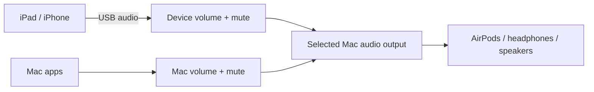

# AudioMix

[](https://creativecommons.org/licenses/by-nc/4.0/)

**Multiple devices. One audio output.**

macOS lacks a built-in audio mixer for combining sound from multiple devices
through a single output. AudioMix was created to solve that problem: listen to
your Mac and an iPad or iPhone together through the same headphones or speakers,
with independent volume controls for each source.

AudioMix is a native macOS audio mixer. Bring audio from an iPad or iPhone over
USB, combine it with Mac audio, and listen through AirPods, speakers, or another
Mac output. Adjust each source independently in a separate Device volumes panel.
No capture card, external receiver, or companion iPad app is required for USB.

**Current version: 0.7 · Early preview · macOS**

Simultaneous USB iPad and Mac playback through AirPods has been verified by the
user. The current DMG build is for Apple Silicon. End-to-end gaming latency has
not been measured.



## What it does

- **USB audio capture:** receive iPad/iPhone playback using native macOS capture APIs.
- **Independent device volumes:** open **Device volumes…** or press **⌘D** for
  a volume slider, percentage, mute, and playback control for each connected input.
- **Separate Mac audio control:** adjust Mac apps without changing the iPad's
  software gain or the output device's hardware volume.
- **Remembered settings:** volume and mute are saved per input across reconnects
  and app restarts. Closing the panel keeps audio running.
- **Selectable output:** use AirPods or another output available to Core Audio.
- **Bounded buffering:** choose a 5, 10, 20, 40, or 80 ms maximum application queue;
  the default is 40 ms. Expired USB audio is discarded rather than replayed late.

## Requirements

- macOS 14 or later; **Mac audio control requires macOS 14.2 or later**.
- An iPad/iPhone, a data-capable USB cable, and an existing trust relationship
  with the Mac.
- An audio output connected to the Mac.
- Capture permissions when macOS requests them.

Hardware testing has used an Apple Silicon Mac on **macOS 26.1** and an iPad on
**iPadOS 26.3.1**. Other OS versions and Intel Macs have not been verified.
Source builds target the architecture of the build machine.

## Install a DMG build

1. Open the AudioMix DMG.
2. Drag **AudioMixWired.app** to **Applications**.
3. Eject the disk image, then launch the app from Applications.

The current test package is **ad-hoc signed**, including both the app and DMG.
It is **not Developer ID signed or notarized**. An ad-hoc signature does not
establish a trusted publisher identity; macOS may block a downloaded copy under
its normal security checks. The package includes a SHA-256 checksum file.

The app currently retains its development name, **AudioMix Wired Test**.

## Connect and mix

1. Connect the iPad/iPhone by USB, unlock it, and accept **Trust This Computer**
   if requested.
2. Click **Refresh**, choose the intended input, and select your Mac audio output.
3. Click **Start audio** and play sound on the device.
4. Open **Device volumes…** to adjust that source or mute it independently.
5. To control Mac apps separately, click **Enable** beside **This Mac** in the panel.

Allow microphone/capture access when prompted. macOS can also require camera-class
permission for an iPad screen/audio input, even when the app adds no video output.
Mac audio control requests **System Audio Recording** access. AudioMix opens only
the input you explicitly choose; it does not automatically use a built-in or
Continuity microphone as a replacement.

If the device is missing, open **Audio MIDI Setup**, enable the iPad/iPhone if
offered, and refresh AudioMix. A device may expose both a USB audio input and a
screen/audio input; use one route per physical device. The optional compatibility
checkbox activates a screen stream and discards its video. It is off by default.

Mac volume control applies to other apps playing to the selected output. Apps
explicitly routed to another output are outside that control. Disable **This Mac**
or quit AudioMix to restore ordinary Mac playback. Stop active sources before
choosing a different output in AudioMix.

## Latency and current limits

USB is the working input route. Wireless device input and automatic route
switching are not implemented. The project does **not** currently provide:

- Per-source or master EQ.
- An iPad-to-Mac Bluetooth audio receiver.
- Wi-Fi audio reception.
- Microphone/voice-chat audio returned to the iPad.
- Adaptive USB clock-drift correction.

The application queue setting measures retained PCM since receipt on the Mac.
It is **not game-to-ear latency** and does not include device capture, operating
system, codec, radio, or headphone buffering. Small queue caps can cause dropouts;
AirPods add their own output delay. Audio scheduling priority cannot remove
those delays.

Mac audio control currently supports a mono/stereo Float32 output with one
physical output stream. Multiple independent USB capture instances are supported
by the controller, but several physical input devices have not been tested
simultaneously. AudioMix remains a prototype; diagnostics and research controls
are still visible in its main window.

## Build from source

Use Xcode command-line tools on macOS. The USB mixer needs no Homebrew packages
or third-party downloads.

```sh
sh tools/build-wired-test.sh
sh tools/test-wired.sh
open build/AudioMixWired.app
```

The app is built at `build/AudioMixWired.app` and signed ad hoc by default.
Quit a running development build before rebuilding it. The tests use Address
Sanitizer and Undefined Behavior Sanitizer and cover PCM decoding, buffer bounds,
concurrent ring access, stale audio, gain/mute independence, and Mac tap routing.

### Create an ad-hoc-signed DMG

```sh
sh tools/package-dmg.sh
```

This packages a copy of the existing app, signs nested executables and the app,
creates a compressed read-only DMG, signs the DMG, and writes its checksum and
signature report under `build/releases/`. The running development bundle is not
modified. On Apple Silicon, the artifact is:

```text
build/releases/AudioMix-0.7-macOS-arm64-adhoc.dmg
build/releases/AudioMix-0.7-macOS-arm64-adhoc.dmg.sha256
```

The script accepts an app path and output directory as optional positional
arguments. It refuses to overwrite an existing image. This is a local packaging
workflow; it does not publish a GitHub release or submit anything to Apple.

## How it works

USB capture uses **AVFoundation/CoreMediaIO** and extracts PCM with **Core Media**.
Each input has its own bounded stereo float ring, atomic software gain, and
**Core Audio AUHAL** output. The realtime output callback allocates no memory and
takes no locks.

Mac audio uses a private **Core Audio process tap** that excludes AudioMix's own
process, preventing USB playback from being captured again. A private aggregate
device puts the tap and physical output in one callback; Mac gain is applied
directly there without an additional application audio queue. Hardware microphone
streams are disabled for that callback.

Audio is processed locally for playback. It is not recorded to disk or uploaded.
The app does not change system default devices, hardware sample rates, global
buffer sizes, or headphone hardware volume.

## Development and research

- [Device volume controls and validation](docs/device-volumes.md)
- [USB and Wi-Fi investigation](docs/wired-and-wifi.md)
- [Retained Bluetooth test app](docs/bluetooth-test.md)
- [Bluetooth investigation](docs/bluetooth-investigation.md)

The Bluetooth receiver experiment is disabled in its runnable research build;
it is separate from normal Bluetooth headphone output, which works through macOS.
The Device Hub/Wi-Fi protocol work is exploratory and does not yet receive audio.

An optional, read-only CoreDevice capability probe can be built with
`sh tools/build-coredevice-probe.sh`, then bundled by rebuilding the wired app.
It requires Rust and registry dependencies; USB audio does not depend on it.
Packaging a bundled probe collects its third-party notices from the local build
cache. The probe starts no media session and changes no pairing or developer image.

## License and third-party components

Copyright © 2026 Lucaslu2010, for original contributions.

Except for third-party material and files with a separate license notice, the
original project source code and documentation are licensed under
[Creative Commons Attribution-NonCommercial 4.0 International
(CC BY-NC 4.0)](https://creativecommons.org/licenses/by-nc/4.0/).
See [LICENSE](LICENSE) for the full legal text.

You may share and adapt the covered material for noncommercial purposes, provided
you give appropriate credit, link to the license, and indicate changes. Commercial
uses requiring permission under copyright are not granted by this license; seek
separate permission from the relevant rights holder. The full license, including
its exceptions and limitations, governs.

Third-party code, assets, and dependencies retain their own licenses. This notice
does not replace those licenses or restrict rights they independently grant.

The optional CoreDevice probe uses the MIT-licensed
[idevice](https://github.com/jkcoxson/idevice) library and Rust dependencies;
the separate Bluetooth research app uses LGPL-2.1-or-later
[libsbc](vendor/libsbc/UPSTREAM.md). The USB mixer does not link libsbc.
See [THIRD_PARTY_NOTICES.md](THIRD_PARTY_NOTICES.md) for the retained licenses.
